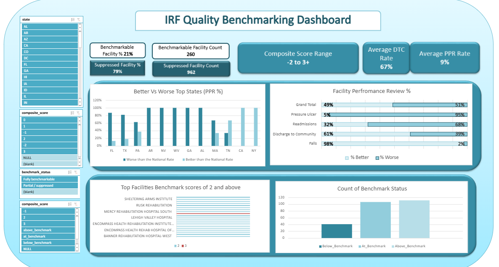
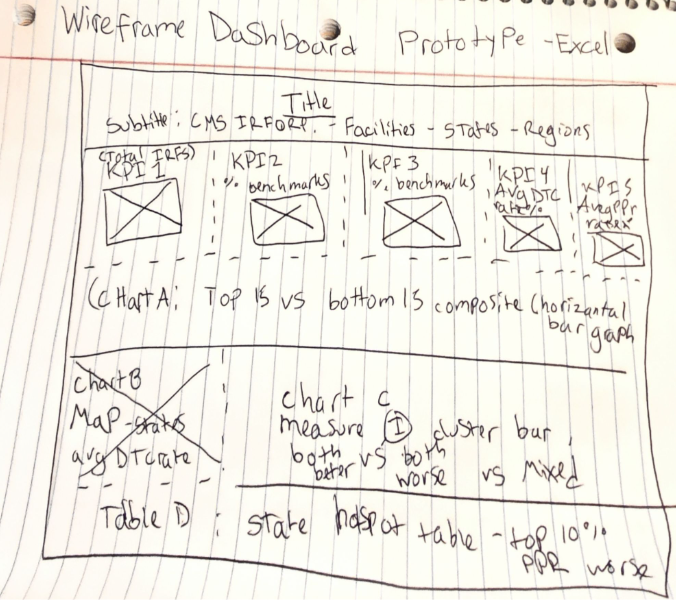
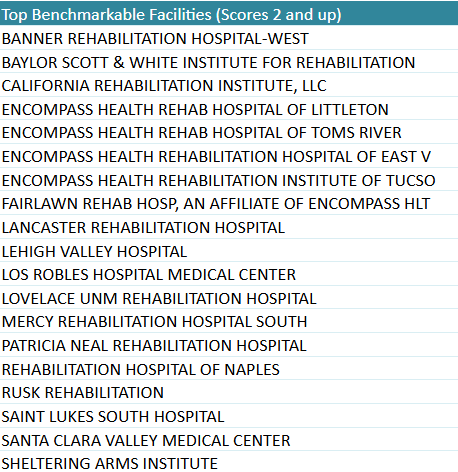
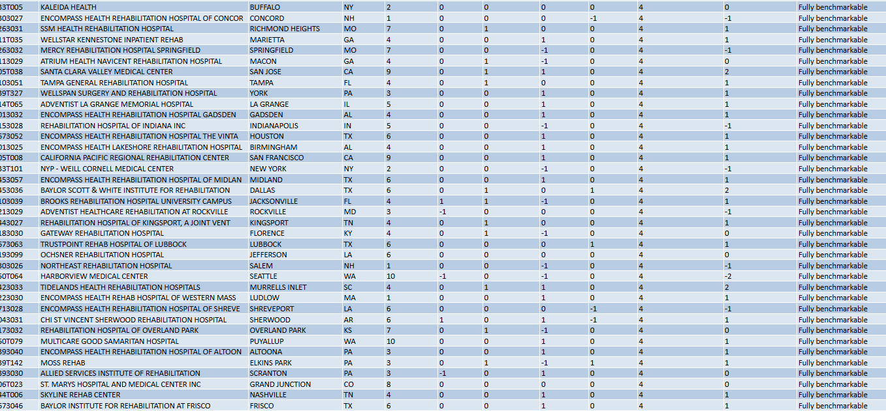
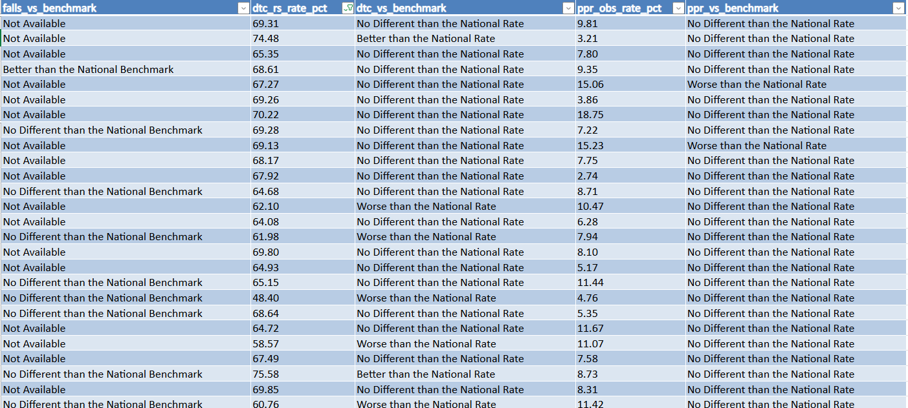
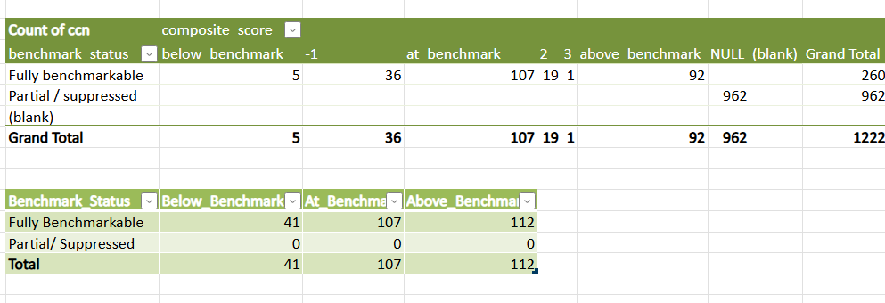
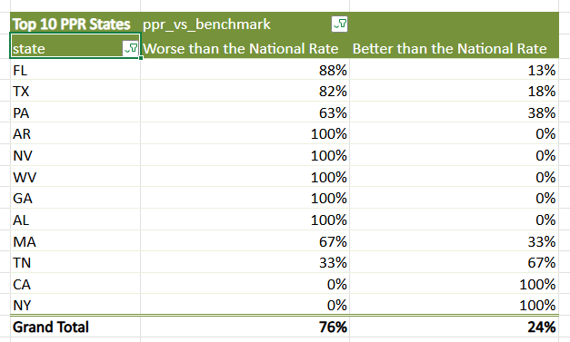

# IRF-Quality-Benchmarking

### Screening Inpatient Rehab Facilities for Referral Networks  

*Part 2 of Project: from SQL pipeline to Excel dashboard* — ranking facilities on CMS quality measures, with a suppression audit that shows why a single composite score can mislead.

[Click here to view Google Doc of full process of my project!](https://docs.google.com/document/d/e/2PACX-1vRiBVKbu1-_ringCSEhFZrBjY1XFhIEEfCHzald2GCQe4fZksjn1WNhj8gSNCyBTWas6M1_vZ0MLiE7/pub)

[Click Here for GitHub Link!](https://github.com/sakurakonami/IRF-Quality-Benchmarking.git)

## Business Problem 

A national post-acute care network is deciding which IRFs to include in its preferred referral network. Leadership wants a defensible way to rank facilities on quality — but CMS publishes quality across four measures (pressure ulcers, falls with major injury, discharge-to-community, and readmissions) on different scales, and many facilities are suppressed on some measures. Can we build a transparent, auditable composite score that ranks facilities, while being honest about how much suppression undermines the ranking? 

## Core Questions
* Which facilities are top performers, and can we trust the ranking?

* Is quality measure-specific or general?

* How many rehab facilities are safe to steer referrals to, and how much does CMS data suppression limit the answer?

## Method
- (Part 1) [Hospital Rehab Analysis](https://github.com/sakurakonami/Hospital-Rehab-Analysis.git) PostgreSQL pipeline: raw CMS → facility scorecard → state/region views → composite index

- (Part 2) IRF Quality Benchmark (*This Project*) Excel dashboard with leaderboard, suppression audit, geographic view, and measure-independence analysis

- Next Steps (Part 3–4): Power BI, then Python

## Tools Used
- Excel Online — full dashboard build: pivots, slicers, KPI tiles, charts, conditional formatting

- Pivot Tables — aggregated ~900 IRF facilities by benchmark status, composite score, measure verdicts, and state

- Pivot Charts — clustered bar charts for % Better vs % Worse per measure; suppression impact chart

- Calculated Fields — derived % Worse (judged) and Better_Count inside pivots without adding source columns

- Slicers — interactive state / region / benchmark-status filters for drill-down

- Data Modeling — joined three tables (irf_composite_index, irf_facility_scorecard, measure_reference) on ccn and measure_code

- Excel Analytics Functions — LET, FILTER, SORTBY, TAKE, HSTACK, COUNTIFS, AVERAGEIFS, IFERROR, XLOOKUP

- Data Cleaning — handled NULL text, "Not Available" verdicts, text-stored numbers, and CMS suppression flags

- Statistical Analysis — % Better vs % Worse, suppression rate, equal-weighted and trimmed averages, top-decile state hotspots

- Dashboard Design — compact KPI cards, Top-10 tables, trust tiles sized for single-screen layout

- Business Framing — translated CMS quality measures into a referral-safety decision framework (Safe / Caution / Cannot judge)

## Steps
**1.)**  Data intake: I uploaded the CMS tables built in Postgres (Part 1, Hospital Rehab Analysis) into Excel, converted each into labeled tables for reliable structured references, and drew a wireframe prototype of the dashboard so users could see the necessary data at a glance.

**2.)**  Top performers (Q1): I built a PivotTable from irf_composite_index with state and provider_name nested as Rows, composite_score (Max) and measures_evaluable (Max) as Values, and benchmark_status as Filter. I copied it beside the original to show bottom performers (Bottom 15 per state by descending minimum composite score), then built a separate KPI pivot comparing fully benchmarkable versus partially suppressed percentages. I later consolidated the tables into one view of top performers with benchmark scores of 2 or higher, and copied the pivot again to display counts instead of percentages.

**3.)** Score range KPI: I pulled the MAX-to-MIN composite score range into a KPI card using =LET(vals,VALUE(Table1[composite_score]),nums,FILTER(vals,ISNUMBER(vals)),MIN(nums)&" to "&MAX(nums)).

**4.)** Measure independence (Q2): I built a curated table of % better and % worse per measure using COUNTIF ratios on the four *_vs_benchmark columns from irf_facility_scorecard, adjusted the benchmark label wording per measure, and formatted results as two-decimal percentages.

**5.)** Average DTC rate KPI: The naive =AVERAGE(Table2[dtc_rs_rate_pct]) returned #DIV/0!. I diagnosed it by confirming COUNTA returned 1222 (data present) while COUNT returned 0 (column was text-stored), then solved it with =LET(r,VALUE(Table2[dtc_rs_rate_pct]),AVERAGE(FILTER(r,ISNUMBER(r)))), divided by 100, and formatted as a two-decimal percentage.

**6.)** Average PPR rate KPI: I reused the same LET + VALUE + FILTER pattern on the PPR rate column for the fifth KPI card.

**7.)** Referral safety and suppression (Q3): I built a PivotTable counting fully benchmarkable versus partial/suppressed facilities from irf_composite_index, grouped the composite score into Below Benchmark (-2 to -1), At Benchmark (0), and Above Benchmark (1 to 3+), and created a second pivot identifying the Top 10% state hotspots for PPR Worse using ppr_vs_benchmark and state. I added the % Better than National Rate for those hotspot states to contrast worst-decile versus better-than-average performance.

**8.)** Final assembly: I assembled all charts, bar graphs, and KPI cards into the final dashboard and added slicers to filter by state, region, and benchmark status.

## Key Findings
Only facilities that are Fully benchmarkable and have no "Worse than national benchmark" verdict qualify as safe to steer referrals to
Roughly 85–90% of IRFs are Partial / suppressed — CMS hides at least one measure, so they cannot be ranked or compared
The referral-safety answer covers only a small, fully-measured minority of facilities
Rankings were restricted to benchmark_status = Fully benchmarkable and measures_evaluable = 4, so every ranked facility was scored on all four measures
The dashboard makes the suppression limitation explicit rather than hidden, so decision-makers see both the recommendation and its confidence level

## Conclusion Summary
This project set out to answer a practical healthcare question: which inpatient rehabilitation facilities are safe to steer referrals to, and how much does CMS data suppression limit that answer? By integrating three CMS datasets into a single Excel dashboard, the analysis produced two clear findings.

- First, only a small minority of facilities qualify as genuinely safe to steer to — those that are fully benchmarkable and carry no "worse than national benchmark" verdict on any of the four quality measures.

- Second, CMS suppression is the dominant constraint: roughly 85–90% of IRFs have at least one measure hidden, meaning they cannot be ranked or compared from public data at all.

The dashboard addresses this honestly rather than hiding it — rankings are restricted to facilities scored on all four measures, and the suppression rate is presented as a first-class KPI so decision-makers see both the recommendation and its confidence level.

The result is a defensible, transparent analytical tool that answers the referral question while making the limits of the underlying data impossible to overlook.

The project is now being extended into Power BI for interactive reporting and Python for automated pipelines and suppression-bias analysis — demonstrating the full analyst workflow from raw CMS data to dashboard to predictive modeling.

*Built a CMS IRF referral-safety dashboard in Excel that quantifies how much data suppression limits real-world decision-making — and is being extended into Power BI and Python for automated, predictive reporting.*

